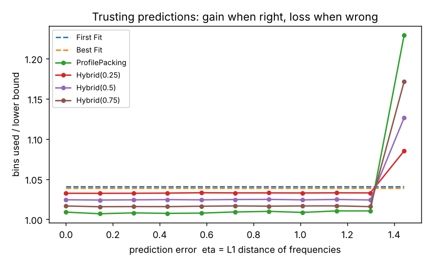
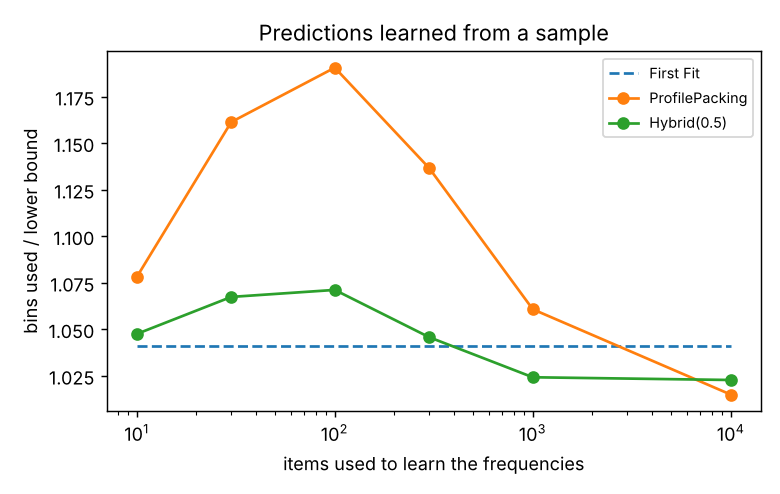

# bin-packing-predictions

Online bin packing, where items arrive one at a time and each must be put in a bin immediately and for good, with and without **predictions** of how often each item size will appear. The repo implements the classic algorithms (Next Fit, First Fit, Best Fit) and the prediction-based *ProfilePacking* and *Hybrid(λ)* of Angelopoulos, Kamali & Shadkami (IJCAI 2022), then measures the core trade-off in learning-augmented algorithms: how much you gain when predictions are good, and how much you lose when they are bad.

## In one paragraph

Classic online algorithms such as First Fit have to work on every possible input, so they are cautious; on typical inputs First Fit uses about 4% more bins than the lower bound. If you know roughly how often each item size will appear, you can plan ahead: ProfilePacking packs an imaginary "profile" of items with those frequencies offline, then fills its slots as real items arrive. With accurate predictions it came within **0.9%** of the lower bound on 100,000 items. When the prediction left out the large sizes entirely, it fell to **23%** above the bound. Hybrid(λ) sends only a λ fraction of each size to ProfilePacking, which caps how bad things can get, at the price of a smaller gain.

## Results

The setup: 100,000 items with integer sizes from round(45·Weibull(3)), bins of capacity 100, profile size m = 5,000, averaged over 3 random sequences (`make experiments`). The score is **bins used ÷ ⌈total size / 100⌉**. Since no packing can beat that lower bound, 1.00 would be perfect.

**1. Prediction quality.** The prediction mixes the true size frequencies with a wrong distribution of small items, with weight δ on the wrong one. The error η is the L1 distance between predicted and true frequencies.

| δ | η | First Fit | Best Fit | ProfilePacking | Hybrid(0.25) | Hybrid(0.5) | Hybrid(0.75) |
|---|---|---|---|---|---|---|---|
| 0.0 (perfect) | 0.00 | 1.041 | 1.039 | **1.009** | 1.033 | 1.024 | 1.017 |
| 0.5 | 0.72 | 1.041 | 1.039 | **1.009** | 1.033 | 1.025 | 1.017 |
| 0.9 | 1.30 | 1.041 | 1.039 | **1.011** | 1.033 | 1.024 | 1.016 |
| 1.0 (all wrong) | 1.44 | 1.041 | **1.039** | 1.229 | 1.085 | 1.126 | 1.171 |

<p align="center"></p>

- **Consistency:** with good predictions, ProfilePacking uses about 3% fewer bins than First Fit (1.009 vs 1.041).
- **Not robust:** at δ = 1 the prediction gives zero frequency to every size above 53, which is 29% of the real items. ProfilePacking then does far worse than First Fit (1.229 vs 1.041).
- **λ is the dial between the two.** Smaller λ gains less when predictions are right and loses less when they are wrong. Hybrid(0.25) is never worse than 1.085.
- **What surprised me:** the L1 error η barely matters until it crosses that threshold. ProfilePacking stayed within about 1% of the bound up to η = 1.30, as long as every size that really occurs had *some* predicted frequency. What hurts is predicting zero for sizes that do appear, not getting the frequencies slightly wrong. A single number like η hides that distinction.

**2. Predictions learned from a sample.** The predicted frequencies are the size counts from the first s items of an independent sample:

| sample size s | η | First Fit | ProfilePacking | Hybrid(0.5) |
|---|---|---|---|---|
| 10 | 1.65 | 1.041 | 1.078 | 1.048 |
| 100 | 0.62 | 1.041 | 1.191 | 1.071 |
| 1,000 | 0.21 | 1.041 | 1.061 | **1.024** |
| 10,000 | 0.06 | 1.041 | **1.015** | 1.023 |

<p align="center"></p>

- **Too few samples hurt pure ProfilePacking.** With s = 100 there are about 70 sizes that occur regularly but only 100 observations, so many sizes get a frequency of 0 or 1/100. The profile is a poor plan, and the algorithm keeps opening new profile groups.
- **Small samples can look better than medium ones.** With s = 10 most sizes are missing from the prediction, so most items go straight to the First Fit fallback, which is why s = 10 looks better than s = 100.
- Hybrid(0.5) beats First Fit once the sample has about 1,000 items. Pure ProfilePacking needs about 10,000.

## How the algorithms work

**Classic online algorithms** (`algorithms.py`). Bins are a NumPy array of remaining capacities.

| algorithm | rule | known asymptotic worst-case ratio |
|---|---|---|
| Next Fit | keep one open bin; if the item doesn't fit, start a new bin | 2 |
| First Fit | lowest-numbered bin with room | 1.7 |
| Best Fit | fullest bin with room | 1.7 |

**ProfilePacking:**
1. Build a profile of m imaginary items: ⌈f′ₓ·m⌉ items of each size x, where f′ is the predicted frequency.
2. Pack the profile offline with First Fit Decreasing. Each resulting bin becomes a *template* of size-labelled slots.
3. When a real item of size x arrives, put it in a free x-slot, preferring a bin that is already in use. If no x-slot is free anywhere, open a new copy of all the templates (a new "profile group").
4. A bin only counts once it holds a real item. Sizes that aren't in the profile at all are packed separately with First Fit.

**Hybrid(λ):** an item that fits a free slot in a bin ProfilePacking is already using always goes there, since it costs nothing extra. Otherwise it goes to ProfilePacking only while fewer than a λ fraction of the items of its size have been sent there, and to First Fit if not. λ = 0 is exactly First Fit and λ = 1 is exactly ProfilePacking, and the tests check both endpoints.

**A small example where predictions help** (tested): 100 items of size 4 arrive, then 100 of size 6, with capacity 10.
- First Fit puts two 4s in each bin, then needs a new bin for every 6: **150 bins**.
- ProfilePacking knows sizes 4 and 6 are equally common, so its template is a bin with one 4-slot and one 6-slot. Every 4 gets a bin with a 6-slot reserved next to it: **100 bins**, which is optimal.

## Tests

`make test` runs 12 tests:
- Next Fit, First Fit and Best Fit on hand-checked examples, including a case where First Fit and Best Fit differ.
- The 4/6 example above: First Fit 150 vs ProfilePacking 100.
- Hybrid(0) = First Fit and Hybrid(1) = ProfilePacking.
- Sizes missing from the prediction fall back to First Fit.
- No algorithm ever beats the lower bound.
- First Fit Decreasing respects capacity.
- The error and lower-bound helpers are correct.

## How to run

```bash
pip install -e ".[dev]"     # or: make setup
make test
make experiments            # ~20 minutes: tables above, artifacts/results.json, robustness.png, learned.png
```

## Limitations

- One item-size family (Weibull) and one way of corrupting predictions. The paper also uses standard benchmark files (BPPLIB) and inputs whose distribution changes over time.
- Scores are relative to the simple lower bound ⌈total size / capacity⌉, so they overstate each algorithm's true ratio to the optimum.
- The profile is packed with First Fit Decreasing rather than an exact solver. The paper's experiments do the same.

## Reference

S. Angelopoulos, S. Kamali, K. Shadkami. *Online Bin Packing with Predictions.* IJCAI 2022; extended version in JAIR 2023. [arXiv:2102.03311](https://arxiv.org/abs/2102.03311). This repo is an independent, simplified reimplementation for learning purposes.
